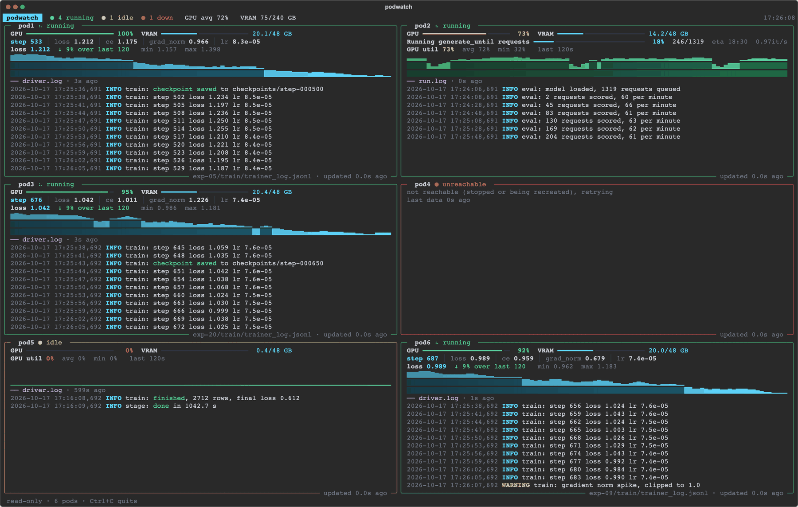
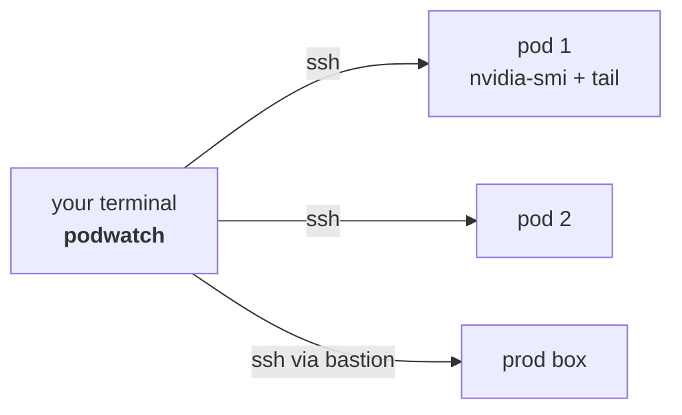

<h1 align="center">podwatch</h1>

<p align="center">
  Every GPU pod in one terminal window.<br>
  No magic. It is a script.
</p>

<p align="center">
  
  
  
</p>

<p align="center">
  
</p>

## Is this a distributed training controller?

No. It is not a load balancer, a cluster manager or an AI either. If you came here from the video: this is the terminal
with the moving bars, and it is a Python script. It SSHes into your machines, asks `nvidia-smi` how it is feeling,
reads the end of a log, and draws the answer with [rich](https://github.com/Textualize/rich). The only magic is `rich`.

It only watches. It never trains, kills or restarts anything. Think `watch nvidia-smi` that went to design school.
Under 1,000 lines of Python, so you can read all of it before you point it at anything you care about.

It is the monitor, not the training code.

## Try it in 30 seconds

No server needed. No GPU either, the mock pods do not have one.

```bash
git clone https://github.com/gayratjon-02/podwatch
cd podwatch
python3 -m venv .venv && source .venv/bin/activate
pip install -e .
podwatch --mock
```

Ctrl+C quits. `--mock --pods 5` adds an idle pod. The mock pods train, evaluate, go idle and drop off the network and
come back, so you can see every state before you have a real pod.

## Watch your own pods

1. `cp pods.example.toml pods.toml` (it is git-ignored, your addresses stay yours).
2. Put your machines in it:

   ```toml
   [[pod]]
   name = "rented-1"
   host = "203.0.113.10"
   port = 40022
   user = "root"
   key  = "~/.ssh/id_ed25519"
   ```

3. Check that `ssh -i ~/.ssh/id_ed25519 -p 40022 root@203.0.113.10 true` works without asking for anything.
4. `podwatch --config pods.toml`

One machine, no ssh: `podwatch --local --root ./runs`.

## Pointing it at production

Production is just a pod with more paperwork.

- **Use a plain account.** Any user that can read the log directory is enough. podwatch never writes, so it needs no
  more than that. Do not give it root because it is convenient.
- **Bastions work.** Set `jump = "ops@bastion.example.com"` (it becomes `ssh -J`). Or define the host in `~/.ssh/config`
  and write only `host = "that-alias"`: when `user`, `port` and `key` are left out, ssh decides, so aliases, `ProxyJump`
  and `IdentityFile` behave as they do in your terminal.
- **No prompts, ever.** It runs ssh with `BatchMode=yes`. Use a key without a passphrase or load it into `ssh-agent`.
- **Host keys.** New hosts are accepted once (`StrictHostKeyChecking=accept-new`) and checked after that. For a fleet,
  fill `known_hosts` first.
- **Nothing is installed on the box.** `podwatch/agent.py` (one short file) is sent through the ssh connection and run
  by the pod's `python3`. It reads files, runs `nvidia-smi` once a second, and writes nothing to disk. Read it, then
  decide.
- **Point `root` at your runs folder**, not at `/`. The folder is walked every 10 seconds.
- **Traffic is small.** About 150 bytes per second while nothing changes. When a log or metrics file changes, that file
  is sent again (around 14 KB for 120 metric records), and every file is resent at least every 30 seconds.

podwatch answers "is my run alive and what is it doing", at 3 AM, from one window. For fleets, history and alerts use
Prometheus with a GPU exporter. They get along fine.

## What it expects from your trainer

Nothing special. In the folder you point it at (`root`), it looks at the files written in the last 30 minutes:

- **The newest `*.log`**: its last lines are shown, coloured by level. `WARNING` is yellow, `ERROR`, `Traceback` and
  `out of memory` are red. A tqdm progress line becomes a real progress bar with percent, count, ETA and speed.
- **The newest metrics file**, `trainer_log.jsonl` by default, one JSON object per line. Any numeric keys are shown and
  one of them (`loss` by default) is charted with its trend. To write one from any loop:

  ```python
  with open("trainer_log.jsonl", "a") as f:
      f.write(json.dumps({"step": step, "loss": loss, "lr": lr}) + "\n")
  ```

A panel with no metrics to chart (an evaluation, an idle pod) shows the GPU load of the last two minutes instead, on a
fixed 0 to 100 scale, so a card that stalls between batches is easy to spot.

## How it works



One ssh connection per pod, kept open. Once a second the pod prints a JSON snapshot, the screen redraws four times a
second. A dropped connection is retried every 15 seconds. A pod is `running` when something was written in the last
60 seconds, `idle` when not, and `unreachable` while ssh fails. The screen fills the terminal and follows its size.

## Options

| Option | Meaning |
|---|---|
| `--config FILE` | watch the pods in a TOML file |
| `--local` | watch this machine; `--root DIR` and `--train-log NAME` choose where to look |
| `--mock` | fake pods; `--pods N` (1 to 8) and `--seed N` |
| `--chart-key NAME` | metric to chart, default `loss` |
| `--lines N` | most log lines asked from each pod, default 30; the screen shows as many as fit |
| `--once` | print one frame and exit; `--width N` sets its width |

Per pod in the TOML file: `host` (an address or an ssh alias), `name`, `user`, `port`, `key`, `jump`, `root` and
`train_log`. Keys at the top of the file are defaults for every pod.

## When it does not work

- **`unreachable` right away.** Run the same ssh command by hand and read its error. A changed host key, a wrong port or
  a missing key are the usual causes. A rented pod that was recreated can come back with a new host key on the same address:
  `ssh-keygen -R "[host]:port"`.
- **A pod shows `running` but no metrics.** The metrics file is named differently (set `train_log`), or its lines are
  not JSON.
- **Colours look odd.** Use a terminal with true colour and Unicode, and make it wide enough for two panels (110 columns or
  more). Narrower than that and the pods stack in one column.

## Development

```bash
pip install -e .
python -m unittest discover -s tests -t .
```

The tests run the pod program through a real local `bash -s`, the same path it takes over ssh.
`agent.py` is what runs on the pod, `streams.py` keeps the connections, `render.py` and `widgets.py` draw the screen,
`mock.py` makes the fake pods, `cli.py` ties it together.

## License

MIT, see [LICENSE](LICENSE).
